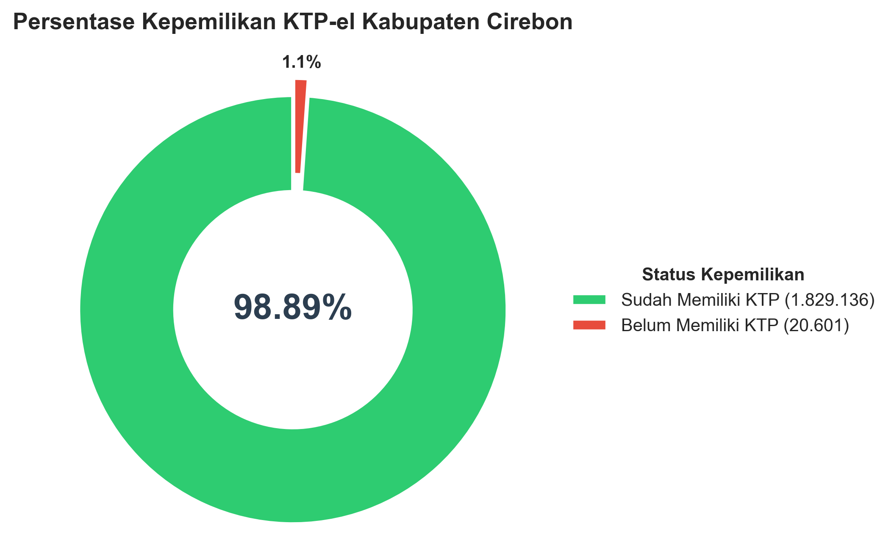
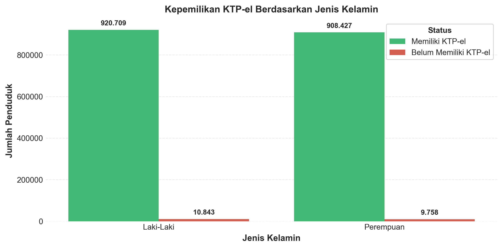
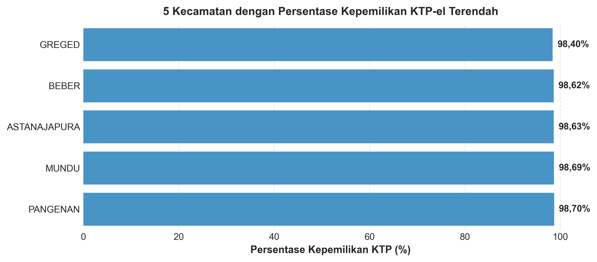
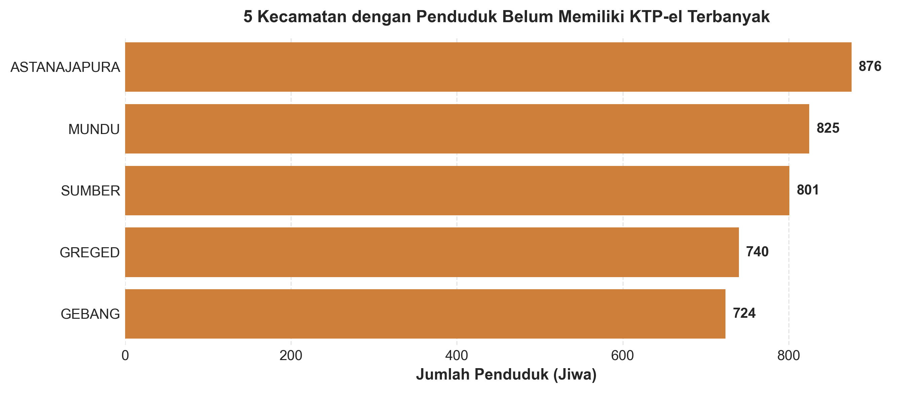
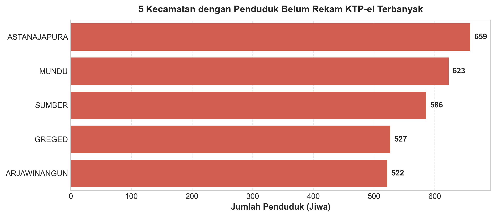
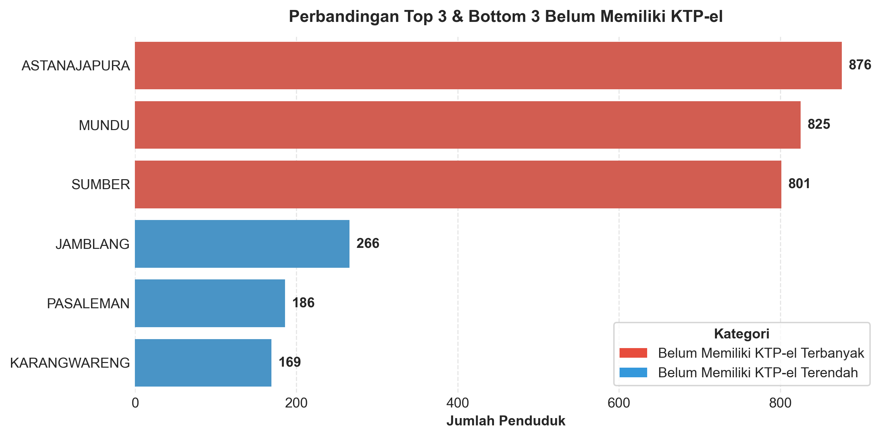
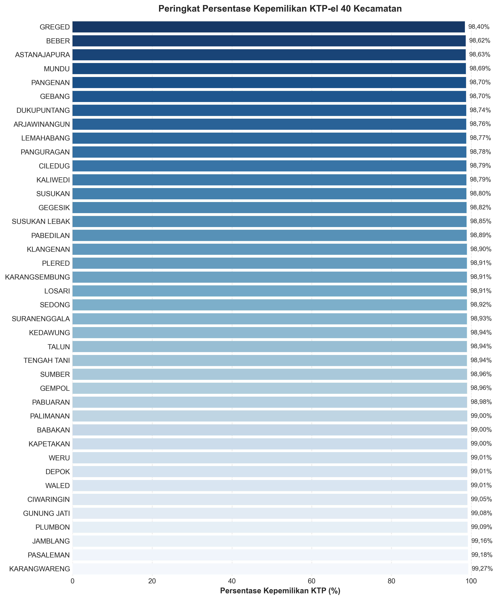

# 🪪 Analisis & Dashboard Kepemilikan KTP-el Kabupaten Cirebon

[](https://www.python.org/)
[](https://streamlit.io/)
[](https://pandas.pydata.org/)
[](KTP.csv)

Repository ini berisi analisis data komprehensif dan aplikasi dashboard interaktif untuk visualisasi statistik **Kepemilikan KTP Elektronik (KTP-el)** di **Kabupaten Cirebon** berdasarkan data 40 kecamatan.

---

## 📌 Ringkasan Data Utama Kabupaten Cirebon

| Indikator | Jumlah / Nilai | Keterangan |
| :--- | :--- | :--- |
| 👥 **Jumlah Wilayah** | **40 Kecamatan** | Wilayah administratif Kabupaten Cirebon |
| 📑 **Total Wajib KTP-el** | **1.849.737 Jiwa** | Seluruh penduduk usia wajib memiliki KTP-el |
| ✅ **Sudah Memiliki KTP-el** | **1.829.136 Jiwa** | **98.89%** dari total Wajib KTP-el |
| ❌ **Belum Memiliki KTP-el** | **20.601 Jiwa** | **1.11%** dari total Wajib KTP-el |
| 📸 **Sudah Rekam KTP-el** | **1.835.196 Jiwa** | **99.21%** dari total Wajib KTP-el |
| ⏳ **Belum Rekam KTP-el** | **14.541 Jiwa** | **0.79%** dari total Wajib KTP-el |
| 👨 **Pemilik KTP-el Laki-Laki** | **920.709 Jiwa** | Belum memiliki: 10.843 Jiwa |
| 👩 **Pemilik KTP-el Perempuan** | **908.427 Jiwa** | Belum memiliki: 9.758 Jiwa |
| 🏆 **Cakupan Tertinggi** | **KARANGWARENG (99.27%)** | Kecamatan dengan persentase kepemilikan tertinggi |
| ⚠️ **Cakupan Terendah** | **GREGED (98.40%)** | Kecamatan dengan persentase kepemilikan terendah |

---

## 📈 Visualisasi & Grafik Analisis

### 1. Proporsi Kepemilikan KTP-el Kabupaten Cirebon
Persentase penduduk Wajib KTP-el yang sudah memiliki vs belum memiliki KTP-el:


---

### 2. Kepemilikan Berdasarkan Jenis Kelamin
Perbandingan jumlah penduduk laki-laki dan perempuan berdasarkan status kepemilikan:


---

### 3. Analisis Kecamatan Prioritas
Perbandingan wilayah dengan persentase terendah serta wilayah dengan jumlah belum memiliki / belum rekam terbanyak:

| 5 Kecamatan Persentase Terendah | 5 Kecamatan Belum Memiliki Terbanyak |
| :---: | :---: |
|  |  |

| 5 Kecamatan Belum Rekam Terbanyak | Top 3 vs Bottom 3 Belum Memiliki |
| :---: | :---: |
|  |  |

---

### 4. Peringkat Persentase Kepemilikan 40 Kecamatan
Peringkat seluruh kecamatan dari persentase terendah hingga tertinggi:


---

## 📋 Tabel Data Kepemilikan KTP-el Per Kecamatan

> [!TIP]
> File data terstruktur juga dapat langsung dilihat dan diekspor dalam format **[KTP.csv](KTP.csv)** (kompatibel dengan tabel interaktif GitHub).

<details>
<summary><b>🔍 Klik di sini untuk melihat tabel data lengkap 40 Kecamatan</b></summary>

| No | Kecamatan | Wajib KTP | Memiliki KTP | Belum KTP | Belum Rekam | KTP (L) | KTP (P) | Capaian (%) |
| :---: | :--- | :---: | :---: | :---: | :---: | :---: | :---: | :---: |
| 1 | WALED | 46.755 | 46.292 | 463 | 340 | 23.378 | 22.914 | **99.01%** |
| 2 | CILEDUG | 37.872 | 37.414 | 458 | 305 | 18.848 | 18.566 | **98.79%** |
| 3 | LOSARI | 51.319 | 50.762 | 557 | 398 | 25.505 | 25.257 | **98.91%** |
| 4 | PABEDILAN | 49.292 | 48.744 | 548 | 382 | 24.282 | 24.462 | **98.89%** |
| 5 | BABAKAN | 58.950 | 58.361 | 589 | 401 | 28.965 | 29.396 | **99.00%** |
| 6 | KARANGSEMBUNG | 29.514 | 29.193 | 321 | 216 | 14.487 | 14.706 | **98.91%** |
| 7 | LEMAHABANG | 45.346 | 44.786 | 560 | 378 | 22.501 | 22.285 | **98.77%** |
| 8 | SUSUKAN LEBAK | 32.996 | 32.616 | 380 | 300 | 16.448 | 16.168 | **98.85%** |
| 9 | SEDONG | 35.014 | 34.635 | 379 | 250 | 17.470 | 17.165 | **98.92%** |
| 10 | ASTANAJAPURA | 64.169 | 63.293 | 876 | 659 | 32.361 | 30.932 | **98.63%** |
| 11 | PANGENAN | 38.046 | 37.551 | 495 | 378 | 19.011 | 18.540 | **98.70%** |
| 12 | MUNDU | 62.872 | 62.047 | 825 | 623 | 31.620 | 30.427 | **98.69%** |
| 13 | BEBER | 35.629 | 35.139 | 490 | 317 | 18.158 | 16.981 | **98.62%** |
| 14 | TALUN | 55.908 | 55.316 | 592 | 387 | 27.975 | 27.341 | **98.94%** |
| 15 | SUMBER | 77.206 | 76.405 | 801 | 586 | 38.663 | 37.742 | **98.96%** |
| 16 | DUKUPUNTANG | 54.357 | 53.672 | 685 | 402 | 26.939 | 26.733 | **98.74%** |
| 17 | PALIMANAN | 49.515 | 49.019 | 496 | 337 | 24.465 | 24.554 | **99.00%** |
| 18 | PLUMBON | 66.383 | 65.781 | 602 | 422 | 33.148 | 32.633 | **99.09%** |
| 19 | WERU | 57.161 | 56.594 | 567 | 429 | 28.956 | 27.638 | **99.01%** |
| 20 | KEDAWUNG | 48.968 | 48.448 | 520 | 315 | 24.152 | 24.296 | **98.94%** |
| 21 | GUNUNG JATI | 65.426 | 64.822 | 604 | 461 | 32.068 | 32.754 | **99.08%** |
| 22 | KAPETAKAN | 49.453 | 48.959 | 494 | 358 | 24.677 | 24.282 | **99.00%** |
| 23 | KLANGENAN | 42.961 | 42.490 | 471 | 327 | 21.362 | 21.128 | **98.90%** |
| 24 | ARJAWINANGUN | 56.802 | 56.096 | 706 | 522 | 28.168 | 27.928 | **98.76%** |
| 25 | PANGURAGAN | 35.997 | 35.558 | 439 | 342 | 17.833 | 17.725 | **98.78%** |
| 26 | CIWARINGIN | 32.263 | 31.958 | 305 | 237 | 15.817 | 16.141 | **99.05%** |
| 27 | SUSUKAN | 58.367 | 57.666 | 701 | 458 | 28.859 | 28.807 | **98.80%** |
| 28 | GEGESIK | 58.680 | 57.988 | 692 | 426 | 29.061 | 28.927 | **98.82%** |
| 29 | KALIWEDI | 33.772 | 33.365 | 407 | 314 | 16.686 | 16.679 | **98.79%** |
| 30 | GEBANG | 55.907 | 55.183 | 724 | 489 | 27.704 | 27.479 | **98.70%** |
| 31 | DEPOK | 53.265 | 52.737 | 528 | 391 | 26.545 | 26.192 | **99.01%** |
| 32 | PASALEMAN | 22.567 | 22.381 | 186 | 146 | 11.196 | 11.185 | **99.18%** |
| 33 | PABUARAN | 30.310 | 30.002 | 308 | 221 | 15.070 | 14.932 | **98.98%** |
| 34 | KARANGWARENG | 23.088 | 22.919 | 169 | 145 | 11.553 | 11.366 | **99.27%** |
| 35 | TENGAH TANI | 36.004 | 35.623 | 381 | 269 | 18.117 | 17.506 | **98.94%** |
| 36 | PLERED | 44.651 | 44.165 | 486 | 336 | 22.358 | 21.807 | **98.91%** |
| 37 | GEMPOL | 37.456 | 37.068 | 388 | 282 | 18.646 | 18.422 | **98.96%** |
| 38 | GREGED | 46.254 | 45.514 | 740 | 527 | 23.423 | 22.091 | **98.40%** |
| 39 | SURANENGGALA | 37.668 | 37.266 | 402 | 282 | 18.558 | 18.708 | **98.93%** |
| 40 | JAMBLANG | 31.574 | 31.308 | 266 | 183 | 15.676 | 15.632 | **99.16%** |

</details>

---

## 📁 Struktur Direktori Repositori

```text
├── KTP.xlsx                          # Dataset sumber format Excel
├── KTP.csv                           # Dataset bersih CSV (tampilan tabel di GitHub)
├── analisis_ktp-el.py                # Script analisis data Python
├── analisis_ktp-el.ipynb             # Jupyter Notebook eksplorasi & visualisasi
├── app.py                            # Dashboard aplikasi interaktif Streamlit
├── export_assets.py                  # Script pembuatan visualisasi & ekspor CSV
├── generate_readme.py                # Script generator README.md otomatis
├── grafik_proporsi_kepemilikan.png    # Grafik Donut proporsi total Cirebon
├── grafik_gender.png                 # Grafik perbandingan gender Laki-laki vs Perempuan
├── grafik_kepemilikan_terendah.png   # Grafik 5 kecamatan persentase terendah
├── grafik_belum_memiliki_terbanyak.png# Grafik 5 kecamatan belum memiliki terbanyak
├── grafik_belum_rekam_terbanyak.png  # Grafik 5 kecamatan belum rekam terbanyak
├── grafik_perbandingan_top_bottom.png# Grafik perbandingan Top 3 & Bottom 3
├── grafik_ranking_semua_kecamatan.png# Grafik ranking 40 kecamatan
└── README.md                         # Dokumentasi utama tampilan antarmuka GitHub
```

---

## 🚀 Cara Menjalankan Proyek Secara Lokal

### 1. Instalasi Dependensi
Pastikan Python 3.9+ telah terpasang, lalu instal dependensi berikut:
```bash
pip install pandas openpyxl matplotlib seaborn streamlit
```

### 2. Menjalankan Dashboard Streamlit
Jalankan perintah berikut pada terminal:
```bash
streamlit run app.py
```

### 3. Menjalankan Script Analisis
```bash
python analisis_ktp-el.py
```

---

## 📚 Sumber Data
Data bersumber dari **Buku Profil Perkembangan Kependudukan Tahun 2025**, Dinas Kependudukan dan Pencatatan Sipil (Disdukcapil) Kabupaten Cirebon.
